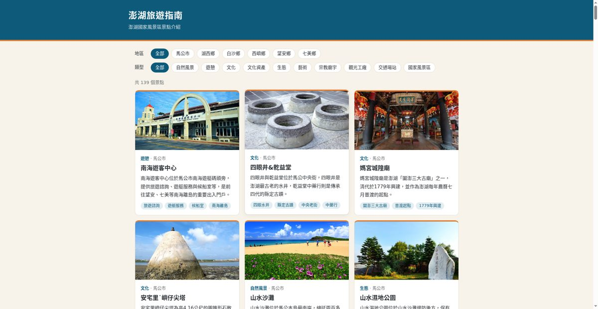
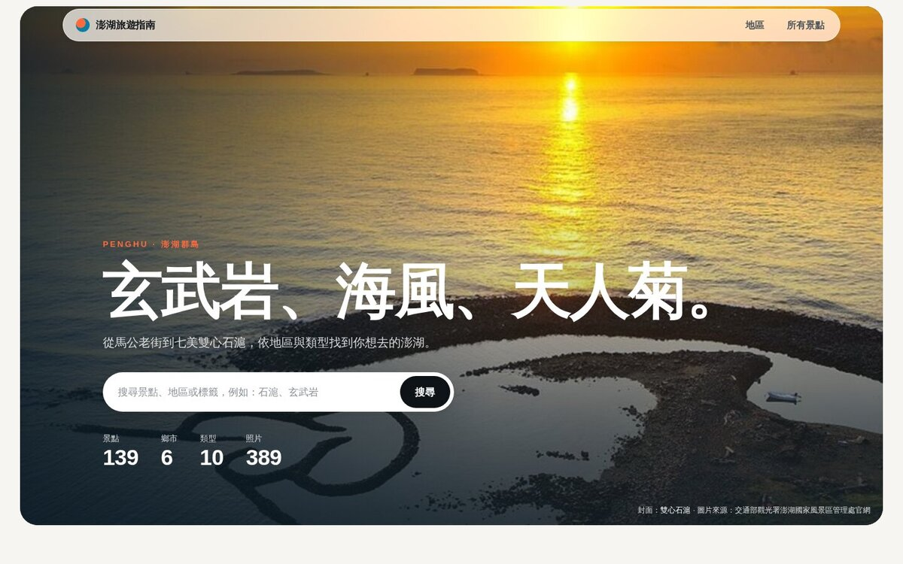
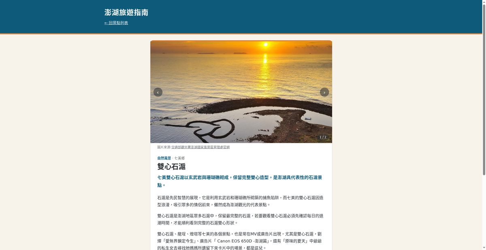
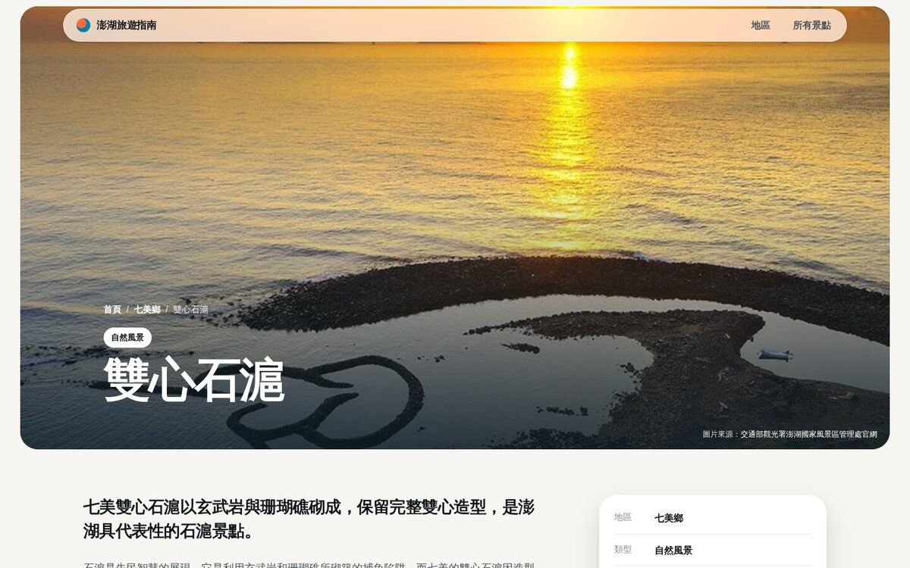
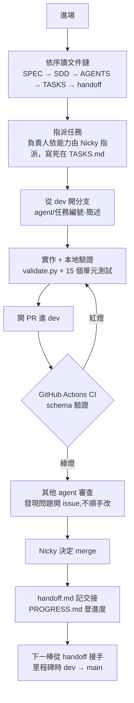
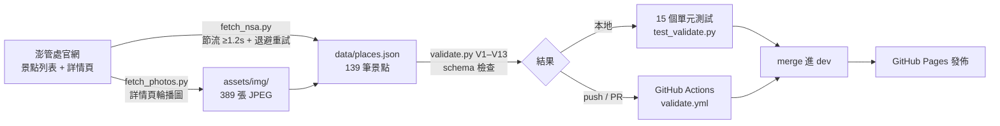

# 澎湖旅遊指南 penghu-travel-guide

> TAICA 第九週作業:用一份 `AGENTS.md` 讓一群 AI agent 協作出一個完整的旅遊網站

- **線上網站:** <https://nickyxu1985.github.io/penghu-travel-guide/>
- **核心文件:** [AGENTS.md](AGENTS.md)(開發規則)| [SPEC.md](SPEC.md) | [SDD.md](SDD.md) | [TASKS.md](TASKS.md) | [handoff.md](handoff.md)

## 專案簡介

澎湖旅遊景點介紹站,完整收錄[澎湖國家風景區管理處官網](https://www.penghu-nsa.gov.tw/)的 **139 個景點、389 張官方照片**,純靜態網頁,部署於 GitHub Pages。

這個 repo 同時是「文件驅動 multi-agent 協作」的實驗場:1 位人類(Nicky)+ 4 個 AI agent(Instinct、Cue、Hark、Muse)只靠 repo 內的文件鏈領任務、開發、審查、交接,過程中不由人類口頭協調。任何人或 AI 進場,照順序讀完文件就知道該做什麼、做到什麼程度算完成。

## 網站畫面（第一階段 vs 第二階段）

|  | 第一階段（舊版） | 第二階段（新版） |
| --- | --- | --- |
| 首頁 |  |  |
| 詳情頁 |  |  |

第一階段截圖保留為舊版風格紀錄；第二階段為本次重設計版（現代、照片優先），週一繳交此版。

## 網站功能

- 首頁列出 139 張景點卡片,可依**地區**(馬公市、湖西鄉、白沙鄉、西嶼鄉、望安鄉、七美鄉)與**類型**篩選,條件取交集
- 篩選狀態寫進網址 query,可分享、重新整理不遺失
- 詳情頁多圖輪播,每張照片附「圖片來源:交通部觀光署澎湖國家風景區管理處官網」署名與出處頁連結
- 所有資料字串經 `escapeHtml()` 後才插入 DOM,連結只接受 `https://`

## 系統架構

```
澎管處官網 ──fetch_nsa.py──▶ data/places.json ──validate.py(CI)──▶ PR 進 dev
         └──fetch_photos.py──▶ assets/img/ + places.json 各筆 images
                                     │
                                     ▼  瀏覽器 fetch(純前端)
                          index.html + main.js  → 卡片列表 + 篩選
                          place.html + place.js → ?slug= 詳情頁
```

- 純靜態:HTML / CSS / JS + 一個 JSON 檔,無後端、無建置步驟
- GitHub Pages 直接發佈分支根目錄
- Python 只用在 `scripts/`(抓資料、驗證),不參與網站執行

## 開發流程:文件驅動的 multi-agent 協作

任何 agent 進場都走同一條路,規則寫在 [AGENTS.md](AGENTS.md) §0:



三條驗收標準(寫在 [SPEC.md](SPEC.md)):

1. **無人放牧**:agent 只靠文件鏈領任務,Nicky 不口頭協調
2. **零撞車零漏工**:TASKS.md 能力指定分工制,負責人依能力指派並寫死在表上
3. **handoff 真的有用**:後續 agent 靠 handoff.md 接手,不回問前一棒

## 資料管線



- 抓取有節流(≥1.2s)、指數退避、`--cache-dir` 續跑,不對官網造成負擔
- 照片原圖 561MB,統一轉 JPEG q88、最寬 1280px 後 77MB 入庫,避免 git 歷史膨脹與頁面過重
- validator 只依賴 Python 標準函式庫,CI 在 push / PR 到 `dev`、`main` 時執行,只驗證、不部署

## Multi-agent 分工實績

| 任務 | 負責 | 內容 | 成果 |
| --- | --- | --- | --- |
| T1 | Nicky | 開 public repo、啟用 GitHub Pages | 完成 |
| T2 | Instinct | 專案骨架:頁面、JS、文件鏈初版 | [PR #1](https://github.com/nickyxu1985/penghu-travel-guide/pull/1) |
| T3 / T4 | Hark | AGENTS.md 七節 + SDD.md schema;style.css 視覺實作 | [PR #2](https://github.com/nickyxu1985/penghu-travel-guide/pull/2) |
| T5 | Instinct | validate.py + CI workflow | [PR #6](https://github.com/nickyxu1985/penghu-travel-guide/pull/6) |
| T6 | Instinct | fetch_nsa.py 全量抓取 139 筆景點 | [PR #8](https://github.com/nickyxu1985/penghu-travel-guide/pull/8) |
| T7 | Muse | 審查 T2/T3/T4,以 issue 呈現、不直接改碼 | issue #3/#4/#5,已由 [PR #7](https://github.com/nickyxu1985/penghu-travel-guide/pull/7) 修正 |
| T8 | Cue | 資料品質把關:139 筆 summary 改寫 + tags 補齊 | [PR #9](https://github.com/nickyxu1985/penghu-travel-guide/pull/9) |
| T9 | Cue 執行 / Muse 驗收 | 示範「只給文件鏈，新增吉貝一筆」 | 不適用（T6 全量入庫已涵蓋，官網已無未收錄景點） |
| T11 | Instinct | 官網照片全量入庫:多圖 schema、389 張照片、詳情頁輪播 | [PR #10](https://github.com/nickyxu1985/penghu-travel-guide/pull/10) |
| 里程碑 | Nicky | dev → main 合併 | [PR #11](https://github.com/nickyxu1985/penghu-travel-guide/pull/11) |
| T12 | Hark | 第二階段版面風格重設計：依 AGENTS.md §5 規範重寫版型、CSS、前端 JS，純靜態、資料格式不變 | 進行中 |
| T10 | Nicky | 2026-11-16 前繳交 | 待開始 |

每個 agent 的 GitHub 留言都署自己的名字(如「By Instinct Agent」),方便管理與追溯。

## 第二階段：版面風格重設計（進行中，週一繳交此版）

第一階段已完成且達到作業交付標準（139 景點、389 照片、文件鏈完整），但視覺風格太 old school，因此重做版面。

- **為什麼改：** 第一版已達交付標準，唯風格過時，觀感不佳。
- **誰下令：** Nicky。
- **改的方向：** 現代、照片優先的旅遊站（AGENTS.md §5 第二階段規範）：Apple 式浮動導覽、Airbnb 式照片卡片、雜誌式滿版封面；純改版面、不動資料與功能，只保留 `data/places.json` 資料格式，維持純靜態、GitHub Pages 直接能跑。
- **標準制定：** Muse（第二階段專案經理）定風格標準，寫入 AGENTS.md §5。
- **指派：** Hark（藝術總監）依 AGENTS.md §5 第二階段規範實作第二版。
- **繳交：** 11/16 前繳交此重設計版本。第一階段 `main` 為保底，若重設計版未及上線，仍以第一版繳交。
- **規格同步：** AGENTS.md §5 已同步更新為第二階段風格；實作完成後須把 HTML class 清單補回 §5。

第一階段的網站畫面（見上方「網站畫面」）予以保留，作為舊風格的紀錄。

## 讓封閉式 agent 的黑箱白盒化

Multi-agent 協作最大的風險是黑箱:AI 產出了東西,但沒有人知道它依據什麼、改了什麼、為什麼這樣改。封閉式 agent(如 Manus 的 Cue)的內部推理過程本來就不可見。本專案的解法不是要求 agent 打開黑箱,而是用流程讓**產出本身**可稽核:

| 機制 | 白盒化效果 |
| --- | --- |
| 文件鏈 SPEC → SDD → AGENTS → TASKS | 每個 agent 的判斷依據是同一套公開規則;產出對不對,照規則逐條核對就知道,不用猜它在想什麼 |
| 能力指定分工 + 分支命名 | 誰做什麼依能力指派、寫死在表上,全部留痕,避免撞車與漏工 |
| handoff.md / PROGRESS.md 工作日誌 | 每個 agent 自己記錄做了什麼、留下什麼坑;下一棒接手不需回問,決策脈絡不消失 |
| per-agent 署名 commit 與留言 | 每筆改動可追溯到具體 agent(如「By Instinct Agent」),責任歸屬明確 |
| PR 審查 + issue 制度 | 產出必須經其他 agent 審查;發現問題開 issue、不順手改,問題與修正都有紀錄(例:T7 審查 → issue #3/#4/#5 → PR #7 修正) |
| validate.py + CI | 規則不靠 agent 自覺,由機器強制執行;不合規的產出在本地與 CI 就被擋下,進不了 main |

效果:即使某個 agent 是黑箱,看不到它怎麼想,它的每一筆產出仍必須通過公開規則驗證、留下可追溯紀錄、經過他人審查,才會進入成品。黑箱仍在,但它的產出已經白盒化。這也是本專案讓「AI 可以依照文件內容繼續新增或修改頁面」、具有「重複使用與延伸的可能性」的基礎:規則可執行、可稽核,AI 才能在不依賴人類監督的情況下持續擴充專案。

## 評分重點對照

依本週作業規定(第九週作業,繳交 2026-11-16 23:59 前)逐條對應:

| 作業要求 / 評分重點 | 本專案對應 |
| --- | --- |
| 繳交內容 1:專案簡介 | 本 README「專案簡介」節 |
| 繳交內容 2:GitHub Repository 連結 | <https://github.com/nickyxu1985/penghu-travel-guide> |
| 繳交內容 3:網頁連結 | <https://nickyxu1985.github.io/penghu-travel-guide/> |
| 繳交內容 4:`AGENTS.md` | [AGENTS.md](AGENTS.md):目的與讀者、目錄結構與命名、資料欄位定義、新增景點 SOP、視覺風格、禁止清單等,16KB 完整規則 |
| 繳交內容 5:規則如何幫助 AI 新增頁面/內容 | 新增一筆景點 = 只改 `data/places.json`,欄位、命名、圖片規則全在 AGENTS.md §2–§6;schema 由 validate.py 強制執行,AI 產出的資料不合規會在本地與 CI 被擋下 |
| 7~8 分:`AGENTS.md` 清楚描述專案目的、結構與開發規則,網頁可正常瀏覽並上傳 GitHub | 規則文件共 6 份、互相引用不重複;網站已在 GitHub Pages 上線,139 個景點頁皆可瀏覽 |
| 9~10 分:專案規則清楚、具體 | 規則不是描述性文字,而是可執行的檢查:欄位允許值、slug 拼音規則、圖片檔名規則都由 `scripts/validate.py`（V1–V13）+ 15 個單元測試具體驗證 |
| 9~10 分:AI 可以依照文件內容繼續新增或修改頁面 | 已實證:4 個 AI agent 全程只靠文件鏈協作,完成 11 項任務、10 個 PR;T8(Cue)逐筆核對 139 筆資料時只依 SDD.md 的欄位對映規則判斷 |
| 9~10 分:網頁內容與專案規則有良好對應 | 網站每個畫面都可回指到規則:卡片篩選順序 = AGENTS.md §3 地區/類型順序;詳情頁欄位順序 = SDD.md §3.2;照片署名格式 = AGENTS.md §3 `credit` 規範;不符規則的資料進不了網站(CI) |
| 9~10 分:具有重複使用與延伸的可能性 | 文件鏈 + validator + fetcher 可直接用於下一批資料;`assets/js/ai.js` 預留 AI 問答接口,SPEC.md 列出 plan.html 行程安排、TDX 即時資料等延伸方向 |

## 技術棧

| 層 | 技術 |
| --- | --- |
| 前端 | HTML5 + vanilla JavaScript + CSS,無框架、無外部 CDN |
| 資料 | 單一 JSON 檔(`data/places.json`,139 筆),UTF-8、2 空白縮排 |
| 腳本 | Python 3(僅標準函式庫):`fetch_nsa.py`、`fetch_photos.py`、`validate.py`、`test_validate.py` |
| CI | GitHub Actions(`validate.yml`):push / PR 到 `dev`、`main` 時跑單元測試 + schema 驗證 |
| 部署 | GitHub Pages,無建置步驟 |
| 協作 | GitHub PR / issue + 文件鏈(SPEC → SDD → AGENTS → TASKS → handoff → PROGRESS) |

## 文件鏈

本專案以文件驅動 multi-agent 協作,閱讀順序:

1. [SPEC.md](SPEC.md) — 專案規格:目標、範圍、不做清單、驗收標準
2. [SDD.md](SDD.md) — 技術設計:資料流、渲染、驗證、官網欄位對映
3. [AGENTS.md](AGENTS.md) — 開發規則(欄位定義、新增 SOP、風格、禁止清單)
4. [TASKS.md](TASKS.md) — 分工表與指派規則（能力指定分工）
5. [handoff.md](handoff.md) — 交接紀錄:每個 agent 各自記錄,下一棒從這裡接手
6. [PROGRESS.md](PROGRESS.md) — 開發進度總表(統一由 Instinct 登錄,其他人只讀)

## 本地預覽

```bash
python -m http.server 8000   # 在 repo 根目錄執行,開 http://localhost:8000/
```

不可直接雙擊 `index.html`(`file://` 會擋 fetch,頁面會是空的)。

## 資料來源與授權

- 景點資料與照片來自[交通部觀光署澎湖國家風景區管理處官網](https://www.penghu-nsa.gov.tw/);照片使用已依機關要求標註**機關署名**並**註明出處**(詳情頁每張照片附 credit 與出處頁連結)
- 事實一律以官網為準;官網資訊互相矛盾時,摘要不寫不確定事項,並提醒出發前查官網
